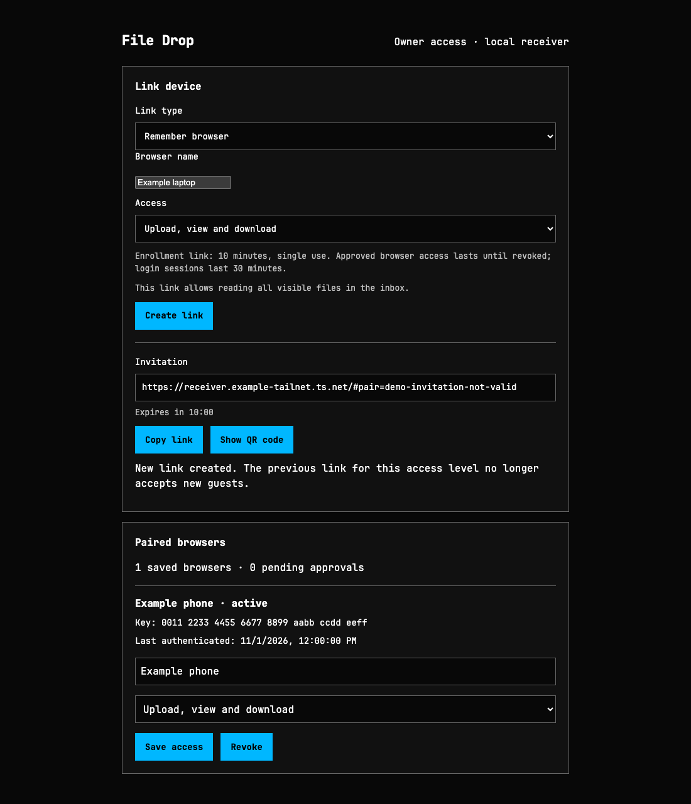
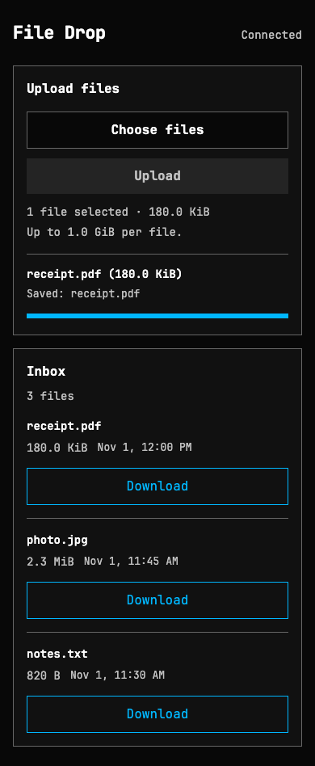

# File Drop

A file-transfer app with one receiving computer and browser clients. Clients use an invitation to upload, list or download files according to their permissions. Files are stored in a dedicated folder on the receiver, not in a cloud storage service.

## Receiver and client

| Receiver / owner page | Client page |
|---|---|
| Create links and QR codes; manage browser access on the receiving Mac. | Upload and download from another computer or phone. |
|  |  |

[Full-size receiver screenshot](docs/images/receiver.png) · [Full-size client screenshot](docs/images/client.png)

*Screenshots use dummy names, links, keys, and files. They do not show a real device or live invitation.*

## What it does

- Transfer files in both directions between browser clients and one receiver.
- Share temporary upload-only, inbox-viewing, or download links.
- Remember approved browser profiles until the owner revokes them.
- Stream files with progress, cancellation, size limits, and no silent overwrites.
- Use private Tailscale HTTPS without cloud file storage.

**Current status:** early, source-built app. The receiver supports macOS only. There is no one-click installer or prebuilt release yet.

## Requirements

| Where | Required |
|---|---|
| Receiving Mac | Go 1.26+, Node.js/npm to build, and Tailscale for the recommended network setup |
| Phone / other computer | A current browser and Tailscale connected to the same authorized tailnet |

Install [Go](https://go.dev/doc/install), [Node.js](https://nodejs.org/en/download), and [Tailscale](https://tailscale.com/download) if needed.

Tailscale can connect devices on the same Wi-Fi or across networks. It uses cloud coordination and may relay encrypted traffic; this app is **not a fully offline or guaranteed LAN-only system**.

## Quick start

### 1. Build on the receiver

Download or clone this repository, then open a terminal in its root:

```sh
npm ci
npm run build
go build -o bin/filedrop ./src
```

Node is needed for building the frontend, not for running the resulting executable.

### 2. Start private HTTPS

Connect Tailscale on the receiver and client. On the receiver, check for an existing Serve configuration before changing it:

```sh
tailscale serve status
tailscale serve --https=443 http://127.0.0.1:8443
```

Follow any prompts to enable HTTPS; leave optional Funnel access unchecked. Keep this terminal running and copy the HTTPS URL it prints.

**Use Serve, not Funnel.** Funnel exposes a service publicly. Restrict receiver access with your tailnet policy. HTTPS certificate issuance makes the device's certificate hostname public; do not use a sensitive machine name.

### 3. Start File Drop

In a second terminal, replace the example URL with the exact origin printed by Serve, without a trailing slash:

```sh
./bin/filedrop \
  -tailscale-serve \
  -share-inbox \
  -allow-downloads \
  -listen 127.0.0.1:8443 \
  -public-url https://receiver.example-tailnet.ts.net \
  -owner-listen 127.0.0.1:18445 \
  -inbox "$HOME/FileDropInbox"
```

Open the **owner link** printed by File Drop on the receiving Mac. Do not send that local owner link to clients.

### 4. Send a file

1. On the owner page, choose temporary access and the required permission.
2. Select **Create link**, then copy the link or show its QR code.
3. Open it on a Tailscale-connected client.
4. Select **Choose files**, then **Upload**.
5. Wait for **Saved**. The file is now in the receiver's inbox.

With download permission, select **Download** in the client inbox; the browser controls where the file is saved. To send a file from the Mac, place it in the dedicated inbox and download it from the client.

Keep the receiving Mac awake and both services running. Stop File Drop with Ctrl+C in its terminal when finished. Existing files remain on disk.

## Remember a browser

Temporary links expire in 10 minutes and guest sessions last 30 minutes. For repeated use, initialize private pairing state **once**:

```sh
./bin/filedrop init -state-dir "$HOME/Library/Application Support/FileDrop"
```

Add this option to the receiver command:

```sh
-state-dir "$HOME/Library/Application Support/FileDrop"
```

On the owner page, choose **Remember browser**, enter a name, and create its invitation. On the client, select **Request pairing**.

Compare the client's key fingerprint with the pending request. Run the displayed confirmation command in a terminal on the receiver and type `yes`. Enrollment and permission increases cannot be approved through the web page alone.

After approval, return to the ordinary receiver URL in that same browser profile. It authenticates with a saved, nonextractable signing key. Clearing site storage, switching profiles, or changing the receiver origin may require pairing again.

The owner can reduce permissions or revoke a paired browser. Those changes invalidate sessions and stop active transfers; they cannot recall bytes already delivered.

To renew an expired owner login without restarting a state-enabled receiver:

```sh
./bin/filedrop owner-link -state-dir "$HOME/Library/Application Support/FileDrop"
```

## How it works

```text
Phone / other PC
      │
      │ HTTPS over Tailscale
      ▼
Tailscale Serve
      │
      │ HTTP over local loopback
      ▼
Go receiver
      │
      ▼
Mac's inbox folder
```

The Go receiver serves the browser UI, validates permissions, and stores or streams files. Tailscale Serve supplies the private HTTPS entry point. Clients do not install a File Drop server, sync folders, or automatically receive files in the background.

See the [technical reference](docs/reference.md) for HTTP APIs, server/client responsibilities, sequence diagrams, storage limits, recovery, and alternative run modes.

## Troubleshooting

| Problem | Check |
|---|---|
| Client cannot open the page | Both devices must be connected to Tailscale; the Mac must be awake and Serve/File Drop running. |
| `tailscale` command not found on macOS | If installed as an app, use `/Applications/Tailscale.app/Contents/MacOS/Tailscale` in place of `tailscale`, or install its CLI. |
| Invitation expired | Create another link on the owner page. Temporary page refresh may require reopening its full invitation. |
| Owner login expired | Use `owner-link` when persistent state is enabled; otherwise restart for a fresh owner bootstrap. |
| Pairing waits for approval | Compare fingerprints and run the receiver-terminal confirmation command. |
| Pairing state is missing or corrupt | Do not delete/reset state casually. Follow the [recovery instructions](docs/reference.md#remember-a-browser). |
| Certificate warning | Stop and correct the URL/HTTPS setup. Do not bypass the warning. |
| Upload rejected | Check the file-size limit, free disk space, available upload capacity, and session permission. |

## Limits and security

- Default upload limit: 1 GiB per file, two simultaneous uploads, 5 GiB received/reserved per run.
- No folder syncing, previews, remote deletion, or resumable transfers.
- Viewing/download access covers the whole visible inbox, not just a client's own uploads.
- Received files are not automatically opened or executed. Keep the inbox away from sensitive, executable, or automation-watched folders.
- Short-lived sessions remain separate from permanent browser pairing.
- Backups require a trust reset **before** a restored registry is served; see the [reference](docs/reference.md#remember-a-browser).

Source reviews and automated tests are not a guarantee of security. Avoid publishing invitation links, credentials, private state, or personal files in issues or screenshots.

## Development

GitHub Actions [CI](.github/workflows/ci.yml) runs on pushes, pull requests, and manual dispatch. It uses a macOS runner for frontend type-check/build, Go race tests and vet, the executable build, and Chromium/Firefox/mobile-WebKit E2E tests. Failure diagnostics are retained for seven days.

CI uses isolated local test receivers and dummy screenshot data, with no Tailscale account, production inbox, or pairing credentials. Actions are pinned to commit revisions and repository permissions are read-only.

```sh
npm run build
npm run typecheck
go test -race ./...
go vet ./...
go build -o bin/filedrop ./src
```

Browser E2E tests:

```sh
npx playwright install chromium firefox webkit
npm run test:e2e
```

Tests cover Chromium, Firefox and mobile-emulated WebKit; emulation is not physical-device coverage. More checks and the source layout are in the [reference](docs/reference.md).

Refresh the dummy UI screenshots without opening live services:

```sh
npm run screenshots
```

This renders the real frontend with intercepted example responses, without accessing your inbox, state, or Tailscale account.

## License

Application code is available under the [MIT License](LICENSE), copyright File Drop contributors.

Third-party components retain their own licenses. Bundled JetBrains Mono uses the [SIL Open Font License 1.1](src/ui/fonts/OFL.txt); its attribution and source are [documented separately](src/ui/fonts/README.md).
