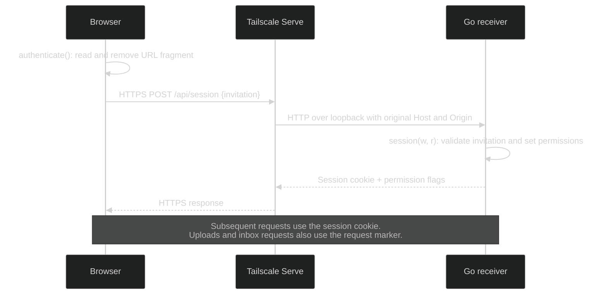
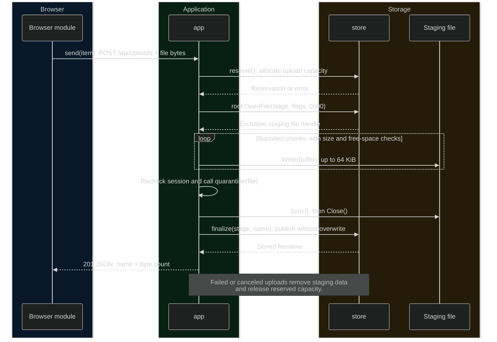
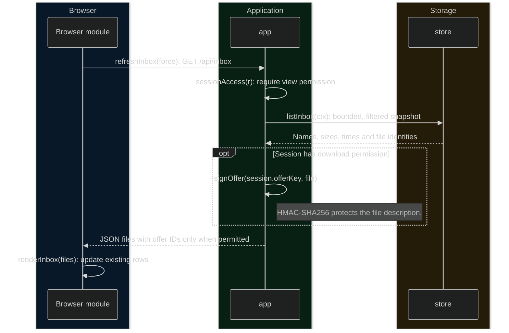
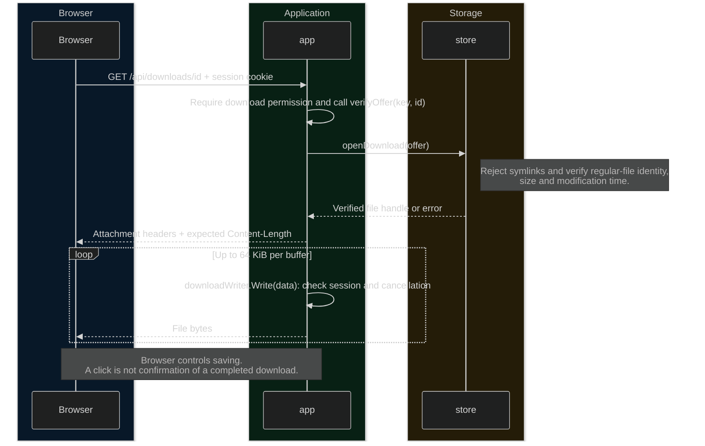

# File Drop

A file-transfer app with one receiving computer and browser clients. Clients use an invitation to upload, list or download files according to their permissions. Files are stored in a dedicated folder on the receiver, not in a cloud storage service.

## Project layout

```text
src/
  main.go                 CLI and process lifecycle
  config.go               Configuration and TLS validation
  server.go               HTTP routes, sessions and permissions
  storage.go              Inbox, staging and upload capacity
  storage_darwin.go       macOS filesystem operations
  download.go             Signed offers and download streaming
  *_test.go               Go tests beside the implementation
  ui/
    index.html            Static interface
    style.css             Local font and simple styling
    fonts/                JetBrains Mono WOFF2 and license
    app.ts                Browser behavior
    dist/                 Generated JavaScript (ignored)
bin/                      Compiled executable (ignored)
go.mod / go.sum            Go dependencies
package.json / lock file   Frontend build dependencies
tsconfig.json              TypeScript settings
```

## Servers and clients

| Component | Responsibility |
|---|---|
| Go receiver | Serves the UI; issues invitations and sessions; checks permissions; streams uploads/downloads; lists inbox metadata; enforces storage and transfer limits. |
| Tailscale Serve, when used | Provides private HTTPS and proxies requests to Go over loopback on the receiving computer. Does not manage the app's invitations or files. |
| Browser client | Selects files, uploads them, shows progress/errors, polls the inbox, and starts native browser downloads. Does not run a background receiver or automatically save files when closed. |
| Local inbox | Stores accepted files on the receiver. Files remain until the receiver's user removes them. |

**One Go server, multiple browser clients.** File contents can move in both directions:

```text
Client -> receiver: upload into the inbox
Receiver -> client: authorized download from the inbox
```

This is a client/server relationship, not a peer-to-peer mesh. A browser cannot push files into another browser's filesystem. A second receiving PC would need its own receiver.

## HTTP API

| Endpoint | Purpose | Required permission |
|---|---|---|
| `POST /api/session` | Exchange an invitation for a session cookie and permission flags. | Valid invitation |
| `POST /api/uploads` | Stream one multipart file into the inbox; return its stored name and size. | Upload |
| `GET /api/inbox` | Return file metadata and signed download offers when permitted. | View inbox |
| `GET /api/downloads/{id}` | Stream an offered file as an attachment. | Download + valid session-bound offer |

The receiver also serves the static page, JavaScript, stylesheet and local font. Upload and inbox responses are JSON; downloads are binary streams. Failures use non-success HTTP status codes.

The server uses Go's `net/http`, multipart parsing, directory-relative filesystem APIs and cryptographic primitives. Browser clients use `fetch`, `XMLHttpRequest` for upload progress, and native file selection/downloads. Tailscale supplies encrypted device connectivity and Serve supplies HTTPS; neither replaces the app's permission checks.

## Build

The receiver requires macOS, Go 1.25+ and Node/npm to build. Clients need a browser. Dependencies are TypeScript and `golang.org/x/sys`; the bundled font's source and license are in [src/ui/fonts/](./src/ui/fonts/README.md).

```sh
npm ci
npm run build
go build -o bin/filedrop ./src
```

The frontend is embedded in the executable. Rebuild TypeScript before building Go after UI changes.

## Run through Tailscale

Install and authorize Tailscale on the receiver and each client. Enable MagicDNS and HTTPS as required by Serve, and restrict receiver access using your tailnet policy.

Check existing Serve configuration before changing it. In one terminal:

```sh
tailscale serve --https=443 http://127.0.0.1:8443
```

Use **Serve, not Funnel**. Funnel is public internet exposure. Verify `tailscale serve status` and `tailscale funnel status`.

In another terminal, using the exact HTTPS origin printed by Serve:

```sh
./bin/filedrop \
  -tailscale-serve \
  -share-inbox \
  -allow-downloads \
  -listen 127.0.0.1:8443 \
  -public-url https://receiver.example-tailnet.ts.net \
  -inbox "$HOME/FileDropInbox"
```

Open the appropriate invitation printed by Go. Keep both programs running and the receiver awake.

Go listens only on loopback in this mode. Serve terminates HTTPS; session cookies remain Secure. The app validates the configured public Host and browser origin rather than trusting forwarded identity headers.

Tailscale uses cloud coordination and can relay encrypted traffic when a direct connection fails. It does not provide cloud file storage for this app. This is **not guaranteed LAN-only or fully offline**. HTTPS certificate issuance publishes the device's certificate hostname in certificate-transparency logs; choose a non-sensitive name. Never share private keys.

Sources: [Serve](https://tailscale.com/docs/features/tailscale-serve), [encrypted relays](https://tailscale.com/docs/reference/derp-servers), [HTTPS certificates](https://tailscale.com/docs/how-to/set-up-https-certificates).

### Other run modes

Direct LAN HTTPS requires a certificate covering the exact public hostname/IP and client trust in its issuer. Do not bypass warnings:

```sh
./bin/filedrop \
  -listen 192.168.1.50:8443 \
  -public-url https://192.168.1.50:8443 \
  -cert /path/to/server.pem \
  -key /path/to/server-key.pem \
  -inbox "$HOME/FileDropInbox"
```

For disposable loopback tests only:

```sh
./bin/filedrop \
  -dev-http \
  -listen 127.0.0.1:8443 \
  -public-url http://127.0.0.1:8443 \
  -inbox "$HOME/FileDropTestInbox"
```

Development HTTP cannot bind to the LAN. Do not tunnel or publicly proxy it. Direct HTTPS is mandatory outside the explicitly configured Tailscale loopback backend.

## Permissions

| Invitation | Receiver flags | Grants |
|---|---|---|
| Upload-only | Default | Deposit files; no listing or downloads. |
| Shared inbox | `-share-inbox` | Upload and view all visible inbox file metadata. |
| Download | `-share-inbox -allow-downloads` | Upload, view and download all visible inbox files. |

Each invitation is a separate unpredictable secret, reusable for 10 minutes. Browser sessions last 30 minutes, with a maximum of 32 sessions. Permission is captured at session creation: an upload-only or metadata-only session never automatically gains download access.

The UI reads the invitation from the URL fragment, removes it, and exchanges it for an HttpOnly, SameSite=Strict cookie. HTTPS cookies are Secure. Reopen an invitation after refreshing; changing the invitation fragment reconnects the updated UI. Restarting revokes old sessions and generates new invitations.

Shared access applies to the **whole visible inbox**, not only one client's uploads, including files present before startup. Keep sensitive or unrelated files elsewhere. No remote file deletion, arbitrary directory browsing, or administrative API is provided.

## Request sequence

One browser request travels through Tailscale Serve to the Go receiver. Serve handles HTTPS; Go handles application permissions. The same return path carries responses.



## Methods and transformed data

Each diagram covers **one operation**. Read top to bottom: solid arrows are calls or outgoing data; dashed arrows are returned values. Participants are the owning module, Go struct, or file handle; arrow labels name methods and parameters.

Dark participant groups identify ownership: **blue = browser, green = Go application, amber = storage**. Tailscale's unchanged transport hop is omitted below. All operations first pass Host/origin checks and session authorization; failed checks return an error before file access.

### 1. Upload: browser bytes become a stored file

The browser sends one multipart file per request. Receiving progress is not success: the server returns 201 only after publication.



### 2. Inbox: files become metadata and permitted offers

Viewing metadata and downloading contents are separate permissions. An offer is a signed file description bound to the current session, not a filesystem path the client can choose.



### 3. Download: a verified offer becomes an attachment stream

The browser initiates this operation only when the user selects Download. A stale, modified or cross-session offer is rejected.



## Storage and transfer behavior

- Uploads stream into private staging files, then publish using a no-overwrite hard link. Collisions get unique names.
- Received files are not automatically opened, previewed, extracted or executed; macOS quarantine metadata is applied.
- Listings exclude hidden/unsafe names, symlinks, subfolders and staging files. Names are rendered as text. Timestamps are modification times, not guaranteed received-at times.
- Listings scan at most 1,000 top-level directory entries, including hidden entries. Larger inboxes return an explicit error.
- Download offers use standard HMAC-SHA256 with a per-session key. Another session cannot reuse an offer; tampering fails.
- Download opening uses a pinned directory handle and kernel-level no-follow basename access. Regular-file identity, size and modification time must still match the offer.
- Downloads stream as `application/octet-stream` with `Content-Disposition: attachment`; the browser controls saving. No JavaScript whole-file buffering.
- Downloads do not support ranges/resume. An interrupted download may leave a partial browser-managed file. The app does not claim that clicking Download means it was saved.
- A local process can modify an opened file during transfer; this is not an immutable snapshot service.

Defaults: 1 GiB per upload; 5 GiB committed plus reserved upload capacity per run; two active uploads and two active downloads; a 1 GiB free-space floor; 15 minutes per transfer. The upload timeout option also sets the download deadline.

Upload admission reserves the full per-file limit. Restart resets the per-run budget, not existing disk usage. Actual-byte and free-space checks still apply. Multipart overhead is capped at 64 KiB; HTTP headers at 16 KiB; invitation bodies at 1 KiB with a five-second deadline.

Cancellation and startup cleanup remove only identifiable staging files. Only one receiver can lock an inbox. Use a local filesystem supporting locking, hard links and quarantine attributes. Files are synced before publication; directory/power-loss durability is not promised.

## Testing

```sh
npm run build
npm run typecheck
go test -race ./...
go vet ./...
go build -o bin/filedrop ./src
```

Tests cover session/invitation expiration, permission separation, Host/Origin boundaries, confined storage, collisions, interrupted uploads, limits, listing filters, download offer tampering/replay, changed sources, symlinks, non-regular sources, attachment headers and transfer cancellation.

Optional large-transfer checks compare hashes without buffering whole files:

```sh
FILEDROP_LARGE=1 go test \
  -run 'TestLarge(ConcurrentUploads|Download)$' -v -timeout 5m ./src
```

Manual acceptance: trusted HTTPS from a second device; upload/download hash comparisons; expired permissions; cancellation; responsive/mobile layout; live refresh; and private Serve/firewall/tailnet exposure.

## Security scope

Authentication and encryption do not make files harmless. Authorized senders can deposit malicious content and consume capacity. Do not place the inbox in executable, web-served, cloud-synced or automation-watched folders.

Tailscale login, access policy, HTTPS configuration and absence of Funnel are external dependencies, not verified by the app. Local malware running as the same user or administrator is outside the protection boundary. Revocation cannot retract already downloaded bytes.

The baseline implementation and the new authenticated download surface received separate bounded read-only security reviews with no verified exploitable findings. That is not proof of security: live attacks, exhaustive dependency review, tailnet policy and filesystem/platform behavior were not independently verified.

Device-specific validation history is kept in an ignored local Markdown file, not this public document. Git ignore does not erase history or protect a file deliberately force-added; inspect staged changes before publishing.
